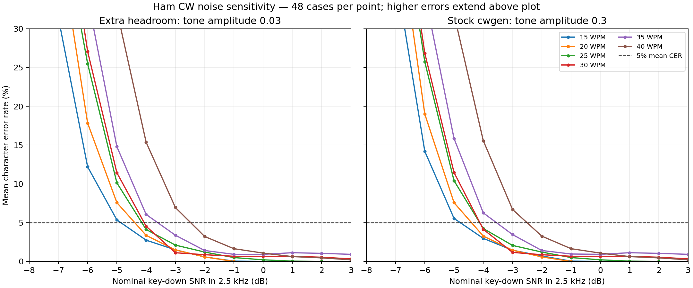

# Ham CW SNR sensitivity

Measured on 2026-10-18 with the current decoder held fixed. The threshold is the
lowest tested SNR at which mean character error rate (CER) stays below or equal
to the stated limit, with every higher tested SNR also passing. Thresholds use
measured points, without interpolation; resolution near the cutoff is 1 dB.
These are Gaussian-noise results with clean timing, not fading, QRM or impulse
noise limits.

## Common speeds with more seeds

Each cell below contains three ham QSO messages and sixteen independent seeds:
48 cases per speed/SNR/generator. The same seeded noise is paired across SNR
levels and generator modes. Default automatic frequency/channel acquisition is
used, with no speed or frequency hints.

SNR is Vail cwgen's nominal **key-down sine power divided by Gaussian noise power
in a 2.5 kHz bandwidth before PCM clipping**. It is not the decoder's displayed
SNR and is not averaged over Morse key-up time.

| WPM | At most 1% mean CER, headroom | At most 5%, headroom | At most 10%, headroom | At most 5%, stock cwgen |
| ---: | ---: | ---: | ---: | ---: |
| 15 | -2 dB | -4 dB | -5 dB | -4 dB |
| 20 | -2 dB | -4 dB | -5 dB | -4 dB |
| 25 | -1 dB | -4 dB | -4 dB | -4 dB |
| 30 | -2 dB | -4 dB | -4 dB | -4 dB |
| 35 | 3 dB | -3 dB | -4 dB | -3 dB |
| 40 | 1 dB | -2 dB | -3 dB | -2 dB |

Both generator levels agree on the refined 5% and 10% limits at these six
speeds. The strict 1% threshold at 35 WPM is nonmonotonic: mean CER is 0.92%
at 0 dB but slightly above 1% at +1/+2 dB, so the sustained rule reports +3 dB.
This illustrates sampling and acquisition variability near a tight error limit.



The plot shows measured means joined for readability. Reported thresholds are
sampled values, not interpolated line crossings. Values above 30% CER extend
beyond the plot; noise-generated insertions can make CER exceed 100%.

## Why two generator levels

Stock cwgen fixes tone amplitude at 0.3 and clips output to signed 16-bit PCM.
As Gaussian noise increases, samples hit those limits. The second executable
changes only `amp = 0.3` to `amp = 0.03`, reducing both signal and noise amplitude
by 20 dB while retaining the requested nominal SNR. It is compiled separately;
the Vail checkout and decoder are unchanged. Binary and source hashes for both
generators accompany the measurements. These are two input-level conditions;
headroom avoids the additional distortion of clipped samples.

| Nominal SNR | Stock samples clipped | Headroom samples clipped |
| ---: | ---: | ---: |
| -3 dB | 1.305% | 0.000% |
| -5 dB | 4.380% | 0.000% |
| -8 dB | 14.583% | 0.000% |
| -12 dB | 35.303% | 0.000% |

Clipping fractions cover the entire generated WAV, including noise-only lead
and tail. No headroom-mode samples clipped in either sweep.

## Every integer speed, initial sweep

The initial sweep has four seeds per message, or 12 cases per speed/SNR/mode.
It covers +3, 0 and −1 through −12 dB at every integer speed from 15 to 40 WPM.
The common-speed table above supersedes its estimates at 15/20/25/30/35/40 WPM
with more seeds over +3 through −8 dB. Small nonmonotonic variations and differences
between the two tables reflect the sampled messages and noise, not a universal
speed-only sensitivity law.

| WPM | At most 1% mean CER, headroom | At most 5%, headroom | At most 10%, headroom | At most 5%, stock cwgen |
| ---: | ---: | ---: | ---: | ---: |
| 15 | -3 dB | -5 dB | -5 dB | -4 dB |
| 16 | -2 dB | -4 dB | -5 dB | -4 dB |
| 17 | -2 dB | -3 dB | -5 dB | -3 dB |
| 18 | -1 dB | -4 dB | -5 dB | -4 dB |
| 19 | -1 dB | -4 dB | -5 dB | -4 dB |
| 20 | -2 dB | -4 dB | -5 dB | -4 dB |
| 21 | -1 dB | -4 dB | -5 dB | -4 dB |
| 22 | -2 dB | -4 dB | -5 dB | -4 dB |
| 23 | -2 dB | -3 dB | -5 dB | -4 dB |
| 24 | 0 dB | -3 dB | -5 dB | -4 dB |
| 25 | -1 dB | -4 dB | -5 dB | -4 dB |
| 26 | -2 dB | -4 dB | -4 dB | -4 dB |
| 27 | -2 dB | -4 dB | -5 dB | -4 dB |
| 28 | -2 dB | -4 dB | -5 dB | -4 dB |
| 29 | -3 dB | -4 dB | -4 dB | -4 dB |
| 30 | -2 dB | -3 dB | -4 dB | -4 dB |
| 31 | -1 dB | -3 dB | -4 dB | -3 dB |
| 32 | -2 dB | -3 dB | -4 dB | -4 dB |
| 33 | -1 dB | -4 dB | -4 dB | -4 dB |
| 34 | -1 dB | -3 dB | -4 dB | -3 dB |
| 35 | -1 dB | -3 dB | -4 dB | -3 dB |
| 36 | 0 dB | -3 dB | -4 dB | -3 dB |
| 37 | 0 dB | -3 dB | -4 dB | -3 dB |
| 38 | 0 dB | -3 dB | -4 dB | -3 dB |
| 39 | 0 dB | -2 dB | -3 dB | -2 dB |
| 40 | 3 dB | -2 dB | -3 dB | -2 dB |

## Measurement method and evidence

- 8 kHz mono PCM from the pinned Vail generator; variable pitch 550–882 Hz.
- Three QSO messages cover CQ/callsigns, a report/name/QTH exchange, and a short
  BK/TU/EE exchange. No expected text is supplied to the decoder.
- Four seconds of silence followed by `md_flush()`, then final current-channel
  text, uppercase and collapsed whitespace. Spaces, punctuation and O/0 count.
- Empty output counts as 100% CER. Every cell retains mean and pooled CER,
  exact/empty cases, worst CER and clipped-sample fraction.
- A sustained threshold must also pass all higher tested levels. A lone passing
  cell below a failed level is retained as `lowest_passing_snr`, but does not
  define the sustained threshold.
- Source, generator, runner, executable and library integrity are checked at
  completion. No decoder tuning or rebuilding occurs during measurement.

The full sweep contains 8,736 cases. Refinement contains 6,912 cases, of which
1,440 overlap identical initial cases, yielding **14,208 distinct cases** in total.
The 48-case means describe these messages and noise seeds; they are not a
per-transmission success guarantee or an independent radio-reception validation.

[Summary, curves, clipping and provenance](wfst-sensitivity.json),
[full raw case report](wfst-sensitivity-full.json.gz),
[refined raw case report](wfst-sensitivity-refined.json.gz).
The raw reports are gzip-compressed JSON with decoded strings and per-WAV hashes.

See [reproduction commands](../../benchmarks/README.md#snr-sensitivity-measurement).
For common-speed refinement, keep the same arguments and add:

```sh
--speeds 15,20,25,30,35,40 --snrs=3,2,1,0,-1,-2,-3,-4,-5,-6,-7,-8 \
--seeds 16 --reuse build-wfst-sensitivity/snr.json \
--output build-wfst-sensitivity/snr-refined-final.json
```

