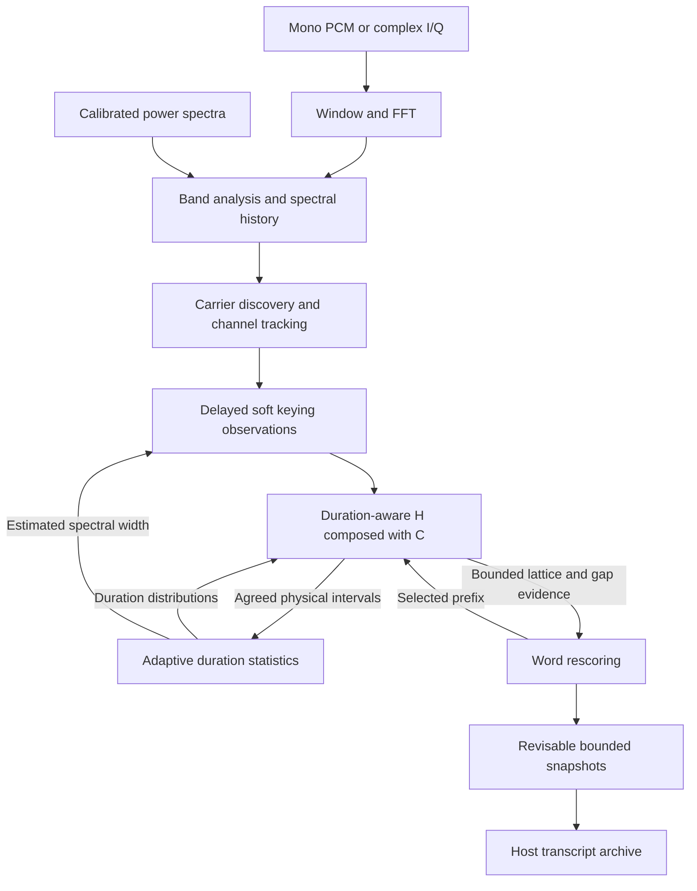

# Decoder design and architecture

libmorsedec is a synchronous C11 library for decoding simultaneous Morse
carriers from mono audio, complex I/Q, or calibrated power spectra. The current
optimization target is ham CW QSOs at 15–40 WPM. That range is a tuning and
validation target, not an API speed limit.

A decoder handle shares frequency analysis and carrier discovery across its
channels. Each channel owns its signal filters, adaptive duration statistics,
streaming acoustic/character search, word scores and bounded message snapshot.
The host supplies input, schedules calls, polls output and archives transcripts.

The acoustic/character search implements a duration-aware H ∘ C weighted
finite-state transducer (WFST): H models keyed/unkeyed durations, and C maps
legal Morse prefixes to character labels. A bounded lattice retains alternative
labels for the ham vocabulary, report, callsign and generic-word graph. Word
evidence helps select characters before text commitment, as well as spacing and
word classifications. Duration learning continues to use agreed physical runs.

Public arguments, errors and buffer contracts are defined in
[`include/morsedec.h`](../include/morsedec.h) and the
[library manuals](man/README.md). This document explains the implementation and
its tradeoffs. Accuracy measurements belong in the
[ham CW benchmark report](benchmarks/wfst-ham.md).

## Pipeline and source layout



| Source | Responsibility |
| --- | --- |
| `src/decoder.c` | Construction, configuration, input APIs, reset/flush and queries |
| `src/frontend.c` | Sample rings, SIMD windowing, FFTW plans and calibrated power |
| `src/band.c` | Spectral history, discovery, channel slots, merging and selection |
| `src/signal.c` | Pitch tracking, normalization, carrier state and soft keying |
| `src/decode_compat.c` | Bridge extraction hooks and source-frame timestamps to WFST |
| `src/statistics.c` | Five duration classes, interval learning and boundary scores |
| `src/wfst_decode.c`, `.h` | Token passing, histories, convergence and acquisition replay |
| `src/wfst_graph.h` | Generated immutable acoustic/character graph |
| `src/word.c`, `src/templates.h` | Word grammar, vocabulary and annotations |
| `src/message.c` | Merge annotated output and retain bounded snapshots |
| `src/parallel.c` | Optional persistent workers for independent channel jobs |

`src/internal.h` connects the modules. The extraction hook named
`md_segment_step()` forwards a probability and timestamp; `struct md_segment`
contains only that timestamp. Character segmentation is performed by the WFST.
File formats, devices, stdin transport, terminal UI and transcript presentation
belong to consumers under `tools/`.

## Handle ownership and lifecycle

Construction copies configuration and allocates the FFT buffers, spectral
history, channel slots, channel-order/job arrays, word graph, per-slot word
scores and optional workers. The word graph is immutable after construction.
The static WFST graph is shared immutable library storage. Mutable state is
owned by a handle or one of its channels.

All configured channel slots reserve their storage up front. Creating or
retiring a track reuses a slot. Processing, pinning, reset and flush reuse the
existing allocations. Destruction joins workers and frees storage; it does not
implicitly flush output.

### Input and call boundaries

Audio handles accept normalized mono float PCM or signed 16-bit PCM. I/Q handles
accept interleaved `I0,Q0,I1,Q1,...`; their sample rates and counts refer to
complex pairs. Either type can instead receive complete power-spectrum frames.

The first successful processing call selects sample or external-spectrum mode
until reset. A zero-count sample call also selects sample mode. Float and s16
representations can be mixed within sample mode. Handle type fixes real audio
versus complex I/Q.

Sample calls accept arbitrary chunk sizes and retain incomplete hops. A call can
produce zero, one or many analysis frames. Non-finite float components become
zero; finite components are clamped to [-1,1]. Signed 16-bit components are
scaled by 1/32768. Input storage is borrowed only during the call.

All calls on one handle, including queries and use of borrowed snapshots, must
be serialized. Separate handles can process concurrently. Construction and
destruction must also be serialized with FFTW planner operations in the host.

### Reset and end of stream

`md_reset()` clears channels, pins, timing, messages, sample rings, counters and
input-mode choice. Configuration, geometry, handle type, storage and worker
budget remain available. The frame counter restarts; the channel-ID allocator
continues increasing so a reset does not reuse previous IDs.

`md_flush()` completes the stream synchronously:

1. Complete a partial sample hop with zeros, then process one second of silence.
   External-spectrum mode instead receives 100 nominal ticks of zero power.
2. Finalize each surviving channel, including pending acquisition replay,
   acoustic/text history commitment and forced word output.
3. Update channel eligibility and select the current channel.
4. Seal the handle. Queries remain available; further input or pin changes
   require reset. Repeated flush succeeds without producing more output.

## Frequency analysis and timebase

### Geometry

For sample rate `fs`, FFT size `N` and hop size `H`, automatic geometry is:

```text
N = 2 * floor(fs * 0.064 + 0.5)
H = floor(fs * 0.010625 + 0.5)
bin_spacing = fs / N
frame_seconds = H / fs
```

Defaults are a 128 ms aperture and 10.625 ms cadence: `N=6144, H=510` at 48 kHz,
or `N=1024, H=85` at 8 kHz. Both have 7.8125 Hz bin spacing. Explicit FFT sizes
must be even, at least 64 and fit an `int`. The hop must fit the FFT and represent
5–20 ms. The library does not resample or decimate input.

Band boundaries are rounded with `floor(frequency*N/fs + 0.5)`. The upper bound
is exclusive, with the appropriate Nyquist limit. At least 32 bins must remain;
channel neighborhoods need ten guard bins at each end. The default audio band
is 200–1200 Hz, retaining 128 bins beginning at 203.125 Hz. Frequency pinning is
clamped to the usable interior. `md_get_geometry()` reports the actual grid.

I/Q frequencies are signed offsets from 0 Hz IF. The default I/Q band is
−1200–1200 Hz. Positive complex rotation, `I=cos` and `Q=sin`, produces positive
frequency. Negative FFT bins are remapped into ascending signed-frequency order.
The complex grid includes negative Nyquist and excludes positive Nyquist. The
library stores no RF-center offset and performs no DC or I/Q-imbalance correction.

### Window and external-spectrum contract

The frontend applies a three-term cosine window multiplied by a centered sinc,
then executes an unnormalized FFT:

```text
a = 2*pi*25*(i - N/2) / fs
sinc(a) = sin(a)/a, with sinc(0) = 1
w[i] = (0.42 - 0.5*cos(2*pi*i/N) + 0.08*cos(4*pi*i/N))
       * sinc(a) * (8000/fs)

real_audio_power = 0.001   * |FFT(w * audio)|^2
complex_iq_power = 0.00025 * |FFT(w * (I+jQ))|^2
```

The sample-rate factor preserves the calibrated power scale. The complex
coefficient compensates for the FFT amplitude difference between a complex
exponential and a real sinusoid of equal peak amplitude. Retained powers use
`float`; non-finite or overflowing computed powers become zero. FFTW's
single-precision `fftwf` frontend, sample/window buffers, extraction filters,
WFST scores, lattice scores and word-grammar scores use `float`.

Windowing splits the circular sample ring into two contiguous spans. SIMDe
processes four real samples or four I/Q pairs per iteration, with unaligned
loads and scalar tails for arbitrary ring positions and FFT lengths. Each
sample still undergoes exactly one multiplication by the same window value.
The FFT itself remains FFTW's responsibility.

### Precision and IEEE-754 operations

Version 0.3.0 uses `float` for every public floating-point field, parameter and
return value, with shared-library ABI 2. Geometry validation and window
coefficient construction retain wider intermediate arithmetic. Duration-model
covariance and acquisition likelihood estimation retain `double`: the existing
partition likelihoods can be smaller than binary32's representable range.
Normal-tail survival values and their differences also retain `double` before
materializing float hazard tables; subtracting nearby rounded tails can erase
small transition probabilities. These exceptions keep numerical range and
initialization behavior stable while the streaming search uses binary32.

On IEC 60559 binary32 targets, alias-safe `memcpy` bit copies implement finite
classification, sign clearing for absolute value, and monotone integer keys for
min/max. The keys distinguish signed zeros. NaN min/max operands use libm to
preserve signaling behavior; non-IEEE builds use standard math fallbacks.
`MD_FLOAT_LIBM` selects the standard-math implementation for controlled benchmarks.
History hashes canonicalize signed zero because the event equality comparison
treats both zeros as equal. No fast or reduced-accuracy transcendental variants
are enabled.

Sliding means use compensated float summation and re-sum on each bounded ring
wrap. Integer frame ages saturate with integer comparisons, avoiding loss of
integer precision in float conversions. Positive nominal delays use truncation
after adding one half, giving the existing rounding without `floor`/`fmax` calls.
Float conversion can change close beam decisions; [the float benchmark](benchmarks/float-refactor.md)
records the resulting CER and CPU tradeoff.

The centered sinc gives an effective main lobe of roughly 40 ms within the
128 ms aperture. Very short marks therefore have wider spectra and less temporal
separation. Changing FFT size also changes the physical width of all fixed-bin
tracking and shoulder neighborhoods.

`md_process_spectrum()` bypasses the frontend. Each call supplies exactly one
linear-power frame on the reported grid, using the same cadence, power scale
and analysis alignment. Nonpositive or non-finite bins become zero. A dB
waterfall or differently normalized FFT does not satisfy this contract.

### Physical time and two kinds of replay

Timing models use a nominal tick of `MD_TICK = 0.010625` seconds:

```text
tick_scale = frame_seconds / MD_TICK
frames(nominal_ticks) = max(1, floor(nominal_ticks / tick_scale + 0.5))
scaled_decay = nominal_decay ^ tick_scale
model_duration = observed_frames * tick_scale
```

The frame counter advances for every spectrum frame, including flush padding.
Source ordinals use this processing timebase, not wall-clock time.

Band history retains 200 nominal ticks, about 2.125 seconds. Newly discovered
channels start at the oldest retained frame and process at most four historical
frames per incoming frame until caught up. In sample mode, processing skips
frames before half an FFT aperture plus 20 ms so the effective main lobe can
arrive. Historical processing uses original source frame numbers, the current
shared noise estimate and live peakiness evidence.

This spectral catch-up reruns the channel pipeline. The WFST's separate
acquisition replay caches only soft observations and does not rerun DSP.

## Carrier discovery and signal extraction

### Shared band analysis

For each input frame, `md_band_frame()`:

1. Advances the frame counter and periodically merges duplicate tracks.
2. Stores the spectrum and updates smoothed power and peakiness evidence.
3. Retires marked slots, suppresses nearby candidates and discovers new tracks.
4. Periodically refreshes the shared noise estimate.
5. Dispatches channel catch-up jobs and waits for completion.
6. Selects the current channel and sorts enumeration by frequency.

Peakiness compares smoothed power with the larger shoulder power five bins to
either side. After history warmup, local maxima above 3.5 become candidates.
Existing tracks suppress candidates within two bins. Periodic merging handles
tracks within three bins, preferring pins/current selection, then carrier
presence and retained message length.

The shared noise estimate is the upper median of up to 40 central retained bins,
refreshed every `frames(32)` frames. It assumes that this band region provides
useful background evidence.

### Per-channel observations

Pitch tracking examines undilated maxima within two bins, gated by peakiness
above 7.5. A smoothed fractional offset produces integer bin moves. Tracking
stays within the ten-bin guards; nearby signals can distract the search.

Each channel normalizes power against a noise floor derived from an 11-tick
running maximum, a 51-tick running minimum and exponential smoothing. Center
amplitude minus shoulder-derived background gives prominence, capped at 200
for threshold adaptation. A 71-tick average drives carrier hysteresis: enter
above envelope 1.3 and remain above 1.0. A 141-tick peak hold reports strength.

Additional extrema and averaging filters build an adaptive keying threshold.
Prominence delayed by 36 nominal ticks, about 382.5 ms, is compared with that
threshold and mapped through `tanh` to a preliminary key probability. Without
carrier, the preliminary probability is 0.003.

A tonal-confidence gate caps this probability using delayed center-to-shoulder
log-power contrast. Shoulder offsets blend from 4–8 bins to 6–10 bins as the
current timing estimate moves from 28 to 34 WPM, accommodating wider short-mark
spectra. The mapping is:

```text
confidence = 0.5*tanh(2*(contrast - log(8))) + 0.5
p_key = max(0.00005, min(preliminary_probability, confidence))
```

High broadband amplitude alone is insufficient evidence for a mark. The current
carrier flag, delayed features and latest timing estimate all affect the result.
The extractor forwards `p_key`, the source frame and an envelope-based low-SNR
flag to WFST. Carrier drop requests another convergence check; it is not EOF.

### Selection and retirement

Internal channel states represent acquisition, decoding, sustained-carrier
waiting and retirement. Training, pinning, carrier changes and inactivity drive
transitions. Automatic selection considers decoding channels with recent output
activity and switches only when another eligible channel has more than four
times the current channel's smoothed absolute power.

A pin protects its track from automatic switching and retirement. Pitch tracking
and other channels continue processing. Retirement makes the old channel ID and
message unavailable to public queries; its slot can be reused with a new ID.

## Adaptive duration statistics

The per-channel statistics state (`c->stats`, called STA below) maintains five
distributions in log-duration units:

| Class | Meaning | Static class prior |
| ---: | --- | ---: |
| 0 | Dot | 0.58 |
| 1 | Dash | 0.42 |
| 2 | Intra-character gap | 0.65 |
| 3 | Character gap | 0.23 |
| 4 | Word gap | 0.12 |

Physical marks have positive durations and gaps negative durations. Statistics
receive agreed physical intervals, rather than individual WFST paths' class
assignments. Zero durations, repeated end ordinals and leading gaps before the
first mark are rejected. Alternating intervals fill a 14-element window.

Seven marks and seven gaps trigger reestimation. The estimator sorts log
durations and scores partitions using within-class residuals, covariance-based
regularization and partition priors. Missing classes are inferred from
dot-relative ratios. For partition fitting, gaps of at least 60 nominal ticks
are replaced by the longest shorter gap, or the current word-gap mean if none
exists. Such long pauses are excluded from individual class updates.

Inferred means classify the window. Covariance-aware updates then adapt stored
means and variances, with bounds on variances and constraints keeping dash means
above dots and word-gap means above character gaps. Updates invalidate WFST
duration tables. The reported PARIS WPM combines dot, dash and intra-character
gap means.

`initial_wpm` shifts the initial means and their regularization. It is a hint,
not a fixed speed or a training flag; supported nonzero hints are 5–80 WPM.
Without a hint, the initial timing prior is approximately 23 WPM.

Two scoring interfaces use these statistics:

- WFST uses discretized lognormal survival probabilities with a predictive
  variance floor determined by acquisition state.
- `md_score()` uses weighted duration densities and broad gap-tail terms for
  interval classification and text-boundary evidence. These are distinct from
  WFST continuation and termination probabilities.

## Streaming acoustic and character search

### Immutable H ∘ C graph

[`scripts/gen-wfst.py`](../scripts/gen-wfst.py) reads `src/codes.h` and generates
`src/wfst_graph.h`: 256 nodes, 831 edges and 50 output-label entries, including
empty output and unknown `*`. Normal library builds use these committed arrays.
The graph requires no runtime construction or Python interpreter.

The topology combines a Morse prefix trie with duration states:

| State | Consumed observation and outgoing behavior |
| --- | --- |
| Idle | Repeat silence or start a root dot/dash |
| Dot/dash | Repeat keyed input, then enter a legal gap class |
| Intra-character gap | Repeat silence, then extend the current Morse prefix |
| Character gap | Repeat silence, then emit the completed symbol at the next root mark |
| Word gap | Repeat silence; start a root mark or emit the symbol while returning to idle |

Every edge consumes one observation; this graph has no epsilon closure. Dot and
dash labels both consume keyed evidence, distinguished by duration and prefix
destination. Gap labels consume silence. Static class priors apply on entry;
illegal trie paths are removed without renormalizing outgoing priors. H ∘ C
contains no dictionary or character-frequency weights. Labels refer to immutable
strings, including lowercase prosign pairs.

Regenerate with `python3 scripts/gen-wfst.py`; `--check` verifies the committed
graph. `--subset` is a development option that replaces the generated graph;
regenerate without it to restore the full table.

### Duration and acoustic scores

Each token holds a node, frame age, accumulated score, physical-run start, most
recent mark frame, current character start and incremental score, a text-history
hash, low-SNR flags and two history heads. Node age and physical-run
duration differ: word-gap and idle states can belong to one continuous silence.

Predictive variance is separate from STA's learned variance:

| Phase | Variance used for duration prediction | Minimum log-duration SD |
| --- | --- | ---: |
| Initial acquisition | `max(STA_variance[k], 0.25)` | 0.5 |
| Released search and replay | `max(STA_variance[k], 0.04)` | 0.2 |

The broader initial distribution admits senders far from the initial speed
prior. Once acquisition releases, narrower predictions distinguish characters
without making a few precise intervals excessively confident. These floors do
not overwrite STA's stored variances.

For lognormal survival `S_k(t)`, age `a` and `dt = tick_scale`:

```text
continue_k(a) = S_k((a + 0.5)*dt) / S_k((a - 0.5)*dt)
terminate_k(a) = 1 - continue_k(a)
```

The decoder evaluates stable log upper tails and bounds continuation to
[1e-6, 1−1e-6]. It caches log continuation and termination as `float`, computing
only visited ages. Timing updates invalidate the tables. Age saturates at 2,048
frames, after which the last probabilities give a geometric tail while physical
source timestamps continue advancing.

Idle uses an onset probability of 0.05 per nominal tick:

```text
q = 1 - (1 - 0.05)^dt
idle_stay_score = log(1-q)
idle_onset_score = log(q)
```

Candidate scores add the source continuation/termination score, static edge
weight and destination acoustic evidence. The common silence likelihood is
subtracted, leaving `log(p_key/(1-p_key))` for marks and zero for gaps. Scores
are normalized each frame. Non-finite probabilities become 0.5; finite values
are clamped to [1e-10, 1−1e-10].

After acquisition, a dash self-loop before its predicted median end
(`frame_age * tick_scale < exp(STA_mean[dash])`) floors negative mark log odds at
−4. This limits damage from a brief dropout during an unfinished dash. Onsets,
dots, gaps and later dash frames keep their original evidence. This adjustment
makes the acoustic score a robust search criterion rather than an exact
likelihood model.

### Adaptive beam and diversity pruning

Each channel has two banks of 100 tokens and scratch for 400 candidates. Steps
accept strictly increasing source ticks; sealed searches and duplicate/older
ticks are ignored. Expansion reserves history capacity, refreshes duration tables
and scores legal transitions. Candidates merge only when state, age, text-history
reference, current character start and last mark agree. Different text histories
can survive in the same physical WFST state.

The beam is measured in natural-log score units below the best candidate:

| Destination/evidence | Width |
| --- | ---: |
| Gap or idle state, low-SNR flag, or unavailable/at-most-0 dB local estimate | 10 |
| Mark with a positive local SNR estimate | 8 |
| Acquisition, before calibrated replay | 8 |

Local SNR uses the learned key-down central-bin power relative to its noise
floor: `square - 1` is the signal/noise power ratio. It is not a 2,500 Hz reference
SNR. A 6-unit mark beam regressed the archived CER gate; the measured design
retains 8 units for marks. The idle shortcut uses the widest beam, preserving
its pruning guarantee.

Rank selection keeps at most 100 candidates. Beam eligibility is computed once
into a channel-owned 400-float score bank. A SIMDe four-lane maximum reduction
and a first-match pass select each survivor. Equal scores keep the earliest
candidate, preserving scalar tie behavior. The score bank follows selections
and diversity penalties; acoustic scores are unchanged. All scans remain
bounded by 400 candidates and 100 selections.

SIMDe is a private, vendored header dependency, pinned to v0.8.2. The normal
build adds no architecture flags or runtime dispatch: SIMDe uses the compiler's
target instructions or its portable fallback. `SIMDE_NO_NATIVE` disables native
intrinsics; adding `SIMDE_NO_VECTOR` also disables SIMDe's compiler-vector path.
No streaming allocations are added.

After each selection, nearby variants of its exact label history pay a 2.0
selection-score penalty. Variants must share the WFST node and differ by at
most two nominal ticks in age, character start and last mark. A hash rejects
different histories quickly; full label comparison
resolves collisions. Before rank pruning, tokens with identical label histories
and physical boundaries within one nominal tick merge. Acquisition retains the
original physical-state merging and skips the diversity penalty. The penalty
changes bank membership, not acoustic scores.
Ties retain expansion order. Banks are restored to acoustic score order for
recovery and acquisition. No surviving candidates causes an idle restart.

### Physical histories and the text lattice

Tokens retain separate physical and text histories in a fixed 4,096-entry pool.
Index zero is the committed root. Pool links, hash values and traceback indices
use 16 bits; the event and bucket capacities are unchanged. Text events record
incremental acoustic scores, first/last mark frames, output labels, following-gap
evidence and the post-label WFST state. Frame normalization never becomes an
edge score: each token separately accumulates the score since its last label.

The common physical ancestor commits agreed run durations to STA. Text histories
are instead projected into a per-channel DAG with at most **64 nodes, 128 edges
and 26 emitted bytes**. Prosign pairs consume two bytes of this window. Paths
join at equal source-time boundaries, post-label WFST states, symbol depths and
byte depths. A mid-gap release also requires equal gap ages at a join. Nodes
are sorted topologically before word rescoring. Parallel arcs
retain different labels, timing, boundary evidence or acoustic scores. Each
terminal carries its unfinished acoustic suffix, keeping heads with different
numbers of completed labels comparable.

A common text prefix can commit while its divergent suffix remains in the
lattice. Before exceeding the depth, node or edge capacity, the word rescorer
chooses a prefix from the represented alternatives. The oldest selected prefix
commits and its nodes are reclaimed. Compatible continuations at the same DAG
boundary survive, with their accumulated scores rebased to the selected prefix.
On capacity overflow, higher acoustic score paths are represented first; this
is an approximation, not an exhaustive posterior distribution.

History pressure first requests lattice rescoring and reclamation. If that
cannot reserve 200 entries for the next frame, the acoustic search retains its
best unfinished token. Acoustic convergence remains independent of speculative
word hypotheses. Counters record forced decisions, recoveries, occupancy,
commits and acquisition replays/drops; these are not confidence estimates.

## Acquisition, replay and finalization

Initial text is withheld while statistics learn. Acoustic convergence still
provides physical intervals. A per-channel ring retains 4,096 soft probabilities,
low-SNR flags and original source ticks: about 43.5 seconds at default cadence.
Overflow drops the oldest observation and increments a counter. A source-tick
discontinuity restarts the cached sequence.

Acquisition can release through these paths:

| Trigger | Requirement and result |
| --- | --- |
| Full statistics window | Fourteen alternating intervals trigger reestimation and mark the channel trained |
| Quiet or acquisition limit | At least three agreed marks, plus 75 quiet nominal ticks or 256 acquisition intervals, release and train |
| Pinned short input | One agreed mark can release during quiet/at the limit; fewer than three marks do not mark it trained |
| Short-transmission best path | At exactly 75 quiet nominal ticks, at least four marks across committed evidence and the best acoustic history permit committing that path and applying the normal release rule |
| Explicit EOF | Pending observations replay even if normal acquisition did not complete |

The short-transmission rule lets an acknowledgment such as TU train before an
unselected channel retires. It requires more evidence than natural convergence;
a three-mark fragment cannot acquire solely through that best-path decision.
Carrier drop alone does not end acquisition. A release with fewer than fourteen
intervals can still use the initial STA means.

On release, the decoder clears its token/history search, invalidates duration
tables and replays retained observations using the released model's variance
floor. Replay enables text events, suppresses duplicate STA training and advances
the committed-time guard. It does not rerun band analysis or signal extraction.
The narrower floor applies even when STA means and variances have not changed.

Replay runs inside the advancing or flushing call and is bounded by ring
capacity. It can increase that call's latency. Ring overflow can lose initial
text; the mechanism does not provide unlimited acquisition recovery.

At EOF, every surviving token closes its physical run and contributes its
termination score and pending symbol, using unknown `*` where needed. The word
rescorer chooses among these alternatives before final commitment. After 150
nominal ticks of observed silence in the best gap hypothesis, pending labels
are released while preserving physical gap states and ages. Other surviving
duration tails need not reach idle first. Released labels are not emitted twice
when their gap eventually ends. An empty transcript may win over
spurious letters. Finalization releases eligible statistics, forces word output
and seals the channel; repeated flushes are inert. Channel retirement tracks
completed candidate-label times separately from published text, so waiting for
lattice convergence does not retire an actively decoded station.

## Word interpretation and output

### Boundary evidence and word grammar

A lattice output label expands into one or two bytes during rescoring and into
character records when its prefix commits. Ordinals
are `final_mark_frame * 256 + byte_index`, preserving source positions for
prosign pairs. Low-SNR flags accumulate along the retained character path.
Intermediate bytes of a multi-byte label receive boundary evidence 0.001.

For the final byte, following-gap duration is scored at text commit time:

```text
a = md_score(STA, character_gap, duration)
b = 0.5 * md_score(STA, word_gap, duration)
boundary = b / (a + b + 1e-12)
```

The word-gap multiplier calibrates ambiguous boundary odds before word scoring.
Gaps over 150 nominal ticks use the forced-boundary sentinel 2.0. A single idle
token also forces pending word output after 150 ticks of physical silence.
EOF forces the final boundary.

The handle's word graph combines vocabulary, report/prosign patterns, callsign
grammar and generic fallbacks. Emitting nodes match literals or character classes;
selector nodes combine non-emitting paths. Outgoing weights are normalized and
stored as log scores. Each channel owns a score array and rolling 26-character
window with saved boundary states.

Generic wildcard words accept punctuation at the digit fallback emission cost,
−5.303, so an unknown token such as CPY? can retain attached punctuation. Dedicated
punctuation paths remain available. This does not require expected messages or
callsigns in the vocabulary.

For each character, emitting states advance from their parents, then selectors
update in construction order with the root last. Boundary evidence biases the
root's new-word hypothesis. Repetition handling can preserve boundaries in
repeated exchanges. Emission reconstructs word types and space counts, merges
the window into the message and normalizes all scores, including the root.
A forced word flush resets the window after merging it.

### Joint lattice and grammar Viterbi pass

The word layer maintains at most eight hypotheses per lattice node. Each carries
a combined score, grammar state, word length and a bounded predecessor index.
Consuming grammar transitions add the existing literal/class emission and graph
scores to the lattice arc's incremental acoustic score. Epsilon selectors
propagate in creation order, with the root closed last; root closure receives
the existing gap-boundary evidence. Selector scratch is fixed at 64 entries and
model construction rejects larger selector graphs. The joint search uses
normalized log probabilities for both word closure and continuation, derived
from the existing boundary evidence. A forced boundary constrains continuation
without adding an artificial path-length bonus. The existing relative-odds
annotation pass runs only after prefix selection.

The root is seeded from the committed prefix's word-state scores. Prosigns use a
fixed intermediate beam between their two bytes. Terminal ranking adds the
unfinished acoustic suffix. Traceback follows at most 26 arcs, and only the
selected prefix reaches the existing annotation/message update machinery.
Alternatives with the same grammar state and word length merge within each
node's beam. This bounded approximation can change character identities before
commitment; it cannot recover paths already discarded by either beam or a
capacity decision. Forced prefixes are final, while word annotations retain
their existing revision behavior. If grammar beam pruning leaves no complete
path, a bounded acoustic Viterbi pass supplies the safety decision using the
same workspace.

### Snapshots and host transcripts

Each channel retains at most 500 character records. Annotated batches can
overlap older output by ordinal. `message.c` keeps an identical overlapping
prefix and replaces the remaining suffix; equality includes the byte, word type,
ordinal, low-SNR flag, boundary evidence and space count. Overflow drops oldest
records in chunks of up to 125.

`md_get_characters()` borrows an array until the next mutating call.
`md_get_text()` copies complete text and annotated spaces into caller storage.
Queries do not consume output. Channel enumeration is sorted by frequency and
can change each frame; nonzero channel IDs remain stable until retirement or
reset. Query ID zero means the current channel. An absent current channel gives
an empty snapshot; an unknown nonzero ID fails with `ENOENT`.

Persistent consumers should archive records by handle, channel ID and ordinal,
apply overlapping revisions, and collect final output after flush. Appending
every snapshot duplicates text. Retired channels and evicted records are no
longer queryable. Frequency getters return −1 when no current channel exists;
state or enumeration disambiguates that sentinel from a valid −1 Hz I/Q offset.

## Concurrency and resource bounds

### Per-channel workers

The optional backend uses pthreads, including winpthreads on MinGW. Thread
budgets include the caller: zero selects the online CPU count automatically,
one creates no workers, and larger values explicitly request parallel processing.
Budgets are capped by channel capacity. `md_get_thread_count()` reports this
resolved maximum, not current participation.

Automatic worker initialization failure cleans up partial state and falls back
to serial. Explicit requests propagate errors. Without the backend, explicit
budgets above one fail with `ENOTSUP`. Reset preserves workers; deletion wakes
and joins them before releasing storage.

FFT, band analysis, lifecycle updates and shared noise estimation run on the
caller. A preallocated job list assigns complete channel pipelines to the caller
and persistent workers. Automatic scheduling stays serial below four runnable
channels; explicit scheduling can use two. Jobs are claimed through a mutex,
only required workers are signaled, and each dispatch copies the caller's
floating-point environment to workers.

Each job advances at most four historical frames through signal extraction,
WFST, statistics, words and messages. Acquisition can additionally replay up to
4,096 observations. Shared band state and graph topology are read-only during
jobs. A barrier waits for all signaled workers before selection, sorting or the
next frame. EOF's final channel-commit loop is serial.

Processing is synchronous and performs no blocking I/O or callbacks. Mutexes,
barriers and OS scheduling can still delay a call. The library assigns no CPU
affinity or scheduling priority. Fixed storage and bounded work do not imply a
hard real-time deadline guarantee.

### Storage limits

| Storage | Capacity |
| --- | ---: |
| Token banks per channel | Two banks of 100 |
| Candidate scratch per channel | 400 records |
| Acoustic/text event pool per channel | 4,096 entries including root |
| History/candidate hash tables per channel | 8,192 / 1,024 slots |
| Duration tables per channel | Five classes through age 2,048, continuation and termination |
| Acquisition ring per channel | 4,096 probability/flag pairs |
| Character lattice per channel | 64 nodes, 128 edges, 26 emitted bytes |
| Joint word hypotheses per lattice node | 8 |
| Epsilon selectors in the shared word model | 64 |
| Word annotation window per channel | 26 characters |
| Message snapshot per channel | 500 records |
| Handle-owned word model | Up to 4,096 nodes and 8,192 edges |

Traceback, selection and reclamation scratch also use fixed channel arrays.
A compile-time assertion bounds inline channel storage to 512 KiB. Construction
also checks separately allocated word-state scores and both channel index slots
against that same total budget. Lattice, grammar hypotheses, sorting, selector
and traceback scratch are embedded in the channel. No streaming allocation is
needed. Inactive slots retain their initialization-time allocations. Shared
topology, frontend storage, worker resources and allocator overhead are outside
the per-channel state-payload budget. On the current 64-bit build, a channel
uses 414,984 bytes including its 618 word states and index slots, leaving
109,304 bytes below the cap. The SIMD score bank accounts for 1,600 bytes
over the preceding float implementation (413,384 bytes). The preceding double
implementation used 523,152 bytes.

For `B` retained bins and `R` history frames, spectral history uses `4*B*R`
bytes. Power, smoothing, ratio and peak arrays add approximately `13*B` bytes.
Frontend arrays use approximately `16*N+8` bytes for audio or `28*N` for I/Q,
excluding FFTW plan internals and allocator overhead. Word topology and worker
storage are additional handle-owned allocations.

A smaller sample rate reduces FFT storage, but does not shrink fixed channel
arrays. Channel capacity is therefore a major memory choice.

## Verification and current limits

`meson test -C build` runs pattern, WFST and serial/parallel checks, plus static
graph regeneration when Python is available. Coverage includes the complete
Morse table at three hop periods, live/EOF output, separate history convergence,
pool pressure/reuse, duration normalization and updates, both predictive widths,
replay cache invalidation, initial speed mismatch, acquisition overflow,
attached punctuation and unhinted short acknowledgments.

Public audio checks cover 8 and 48 kHz. Other checks cover non-finite
observations, reset/flush and multiple-carrier equivalence. Linux link wrappers
guard streaming allocation/free and inject worker/allocation failures. Serial
and ASan/UBSan builds exercise the same implementation.

The [ham CW benchmark report](benchmarks/wfst-ham.md) records real-QSO results,
a Vail `cwgen` sweep at every integer speed from 15 to 40 WPM, the original
synthetic grids, source/input checksums, CPU measurements and remaining errors.
Accuracy gates compare both mean and pooled CER. [CPU cost](benchmarks/lattice-speed.md)
is measured separately; the preceding double lattice uses 4.23–6.77 times the
streaming CPU of the rebuilt pre-lattice control on five measured inputs. The
[float refactor](benchmarks/float-refactor.md) reduces CPU by 3.3–10.5% against
that double lattice in a fresh comparison.
Synthetic final-channel text and chronological recording snapshots use different
assembly policies. The [lattice CER gate](benchmarks/lattice-gate.md) compares
the lattice decoder with those archived results using identical WAV checksums
and scoring conventions. These development results are not an API accuracy
guarantee.

Current limits include the frontend's temporal response, shared central-band
noise estimate, close-carrier ambiguity, bounded acquisition/history retention
and forced prefix decisions after bounded lattice/beam pruning. Jitter, impulses
and handoffs can still cause errors. Acquisition replay, long-gap alternatives and worker
scheduling affect latency. Word interpretation remains downstream of acoustic
search, and fixed channel storage limits suitability for small-memory systems.
