# Decoder design and architecture

libmorsedec is a synchronous C11 library for decoding simultaneous Morse carriers
from mono audio, complex I/Q, or calibrated power spectra. Frequency analysis and
carrier discovery are shared within a decoder handle. Each tracked channel owns
its extraction filters, adaptive timing model, acoustic/character search, word
scores and message history.

The acoustic/character decoder is a streaming, duration-aware weighted finite-state
transducer (WFST) implementing the H ∘ C layer. A separate word graph interprets
its committed characters. Word evidence does not feed back into the acoustic
search. The host owns devices, input transport, call scheduling and persistent
transcripts; the library provides processing calls and polled snapshots.

This document describes the implementation in `src/`. Public ownership rules,
arguments and error contracts are specified in [the library manuals](man/README.md)
and [`include/morsedec.h`](../include/morsedec.h).

## Data flow and module boundaries

```mermaid
flowchart TD
    PCM[Mono PCM or complex I/Q] --> FFT[Window and FFT]
    FFT --> BAND[Band analysis and spectral history]
    EXT[External calibrated power frames] --> BAND
    BAND --> TRACK[Carrier discovery and per-channel tracking]
    TRACK --> SIGNAL[Envelope extraction and soft keying probability]
    SIGNAL --> HC[Duration-aware H ∘ C token passing]
    HC -->|Agreed physical intervals| STA[Adaptive duration statistics]
    STA -->|Updated emission model| HC
    STA -->|Timing-derived contrast width| SIGNAL
    HC -->|Converged output symbols| WORD[Word graph and boundary interpretation]
    WORD --> MSG[Bounded revisable message snapshots]
    MSG --> HOST[Host queries and transcript archive]
```



FFT and band analysis run on the calling thread. The complete per-channel path
runs as one job on either the caller or a persistent worker. Every spectrum frame
ends with a barrier before channel selection and sorting. There are no stage
queues, callbacks or asynchronously delivered messages.

| Source | Responsibility |
| --- | --- |
| `decoder.c` | Construction, geometry, input entry points, reset/flush and public queries |
| `frontend.c` | Sample rings, analysis window, FFTW plans and calibrated retained-bin power |
| `band.c` | Spectral history, peak evidence, channel slots, replay scheduling, merging and selection |
| `signal.c` | Frequency tracking, envelope filters, carrier state and delayed keying observations |
| `decode_compat.c` | Forward the extractor's `md_segment_*` hooks into WFST decoding |
| `statistics.c` | Five duration distributions, physical-interval learning and boundary scores |
| `wfst_decode.c` / `.h` | Bounded token passing, duration hazards, acquisition replay and convergence |
| `wfst_graph.h` | Generated immutable acoustic/character topology and output strings |
| `word.c` | Word-model construction, per-channel word scores and revisable annotations |
| `message.c` | Merge overlapping annotated batches and retain bounded snapshots |

`src/internal.h` connects these modules. `segment.c` and `character.c` are no
longer part of the decoder. The remaining `struct md_segment` contains only
`step`, a source-frame timestamp written by `signal.c`; it is not a segmentation
buffer. Internal helpers use the same `md_` prefix as public functions but are
hidden from the shared-library interface.

## Ownership and lifecycle

A handle owns its configuration, FFT geometry and buffers, spectral history,
channel slots, channel-order/job arrays, worker pool and word-model graph.
Construction builds the word model and allocates a word-score array for every
configured channel slot. The word graph is read-only during processing; scores
and character windows belong to individual channels. The static WFST graph is
shared immutable storage in the library image, while all WFST runtime state is
channel-owned. Separate handles have independent mutable decoding state.

All stream storage is reserved at construction. Creating or retiring a channel
uses an existing slot. Processing, pinning, reset and flush reuse allocations;
there is no allocation or deallocation in the streaming decoder path. Destruction
joins workers and releases storage without implicitly flushing output.

### Input modes

`md_new()` and `md_new_with_threads()` create real-audio handles.
`md_new_iq()` and `md_new_iq_with_threads()` create complex I+jQ handles. Audio
frequencies are nonnegative Hz; I/Q frequencies are signed offsets from the input
IF center at 0 Hz. I/Q counts and sample rates refer to complex pairs, with input
laid out as `I0,Q0,I1,Q1,...`.

Either handle can accept externally computed power spectra instead of samples.
The first successful processing call selects sample or spectrum mode until reset;
a zero-count sample call also selects sample mode. Float and signed 16-bit
representations can be mixed within sample mode. Switching real audio to I/Q
requires a different handle.

Sample calls accept arbitrary chunk sizes. A partial hop stays buffered, and a
call may produce zero, one or many spectrum frames. The host must serialize all
calls on one handle, including queries and use of borrowed views. Independent
handles can process concurrently. Construction and destruction must also be
serialized with FFTW planner operations in the host application.

### Flush and reset

`md_flush()` is an end-of-stream operation:

1. For sample input, complete any partial hop with zeros, then process one second
   of zero samples. For spectrum input, process 100 nominal ticks of zero power.
2. For every surviving channel, release eligible acquisition, replay any pending
   WFST acquisition observations, and finalize the best remaining acoustic path.
3. Flush the word layer, update channel eligibility and reselect the current
   channel.
4. Seal the handle. Queries remain available; further input and pin/unpin
   operations require reset. Repeated flush is idempotent.

`md_reset()` discards the active channels, pins, buffered input, learned timing,
messages and input-mode choice. It preserves configuration, handle type, geometry,
allocated storage and worker budget. The frame counter restarts at zero; the
channel-ID allocator continues increasing so old IDs are not reused by reset.

## Frequency analysis and timebase

### Geometry and calibration

Let `fs` be the sample rate, `N` the FFT size and `H` the hop size. Automatic
geometry is:

```text
N = 2 * floor(fs * 0.064 + 0.5)
H = floor(fs * 0.010625 + 0.5)
bin_spacing = fs / N
frame_seconds = H / fs
```

Defaults give a 128 ms aperture and 10.625 ms cadence: `N=6144, H=510` at
48 kHz, or `N=1024, H=85` at 8 kHz. Both have 7.8125 Hz bin spacing. Explicit
FFT sizes must be even, at least 64 and fit an `int`; the hop must be no larger
than `N` and represent 5–20 ms. There is no internal resampling or decimation.

Requested band boundaries are rounded with `floor(frequency*N/fs + 0.5)`; the
rounded upper boundary is exclusive, subject to the Nyquist limit. At least
32 bins must remain. Per-channel neighborhoods require ten guard bins at either
end. The default audio band, 200–1200 Hz, retains 128 bins starting at 203.125 Hz;
pinning is clamped to the usable interior. `md_get_geometry()` reports the actual
grid. Changing FFT size changes both analysis timing and the Hz width of the
fixed-bin neighborhoods.

The frontend applies a three-term cosine window multiplied by a centered sinc:

```text
a = 2*pi*25*(i - N/2) / fs
sinc(a) = sin(a)/a, with sinc(0) = 1
w[i] = (0.42 - 0.5*cos(2*pi*i/N) + 0.08*cos(4*pi*i/N))
       * sinc(a) * (8000/fs)

real audio power = 0.001   * |FFT(w * audio)|^2
complex IQ power = 0.00025 * |FFT(w * (I+jQ))|^2
```

The FFT is unnormalized. The window's sample-rate factor maintains the calibrated
power scale; the complex coefficient compensates for the amplitude difference
between a complex exponential and a real sinusoid of equal peak amplitude.
Absolute power matters for acquisition and selection, not only power ratios.
The sinc narrows the effective temporal response to roughly 40 ms despite the
128 ms aperture, limiting separation of very short Morse elements.

Float sample components are clamped to [-1,1], with non-finite values replaced by
zero. Signed 16-bit components are divided by 32768. Retained power is stored as
`float`; non-finite or overflowing computed powers become zero. Most internal
filtering and scoring uses `double`.

The forward complex FFT maps `I=cos(2*pi*f*t), Q=sin(2*pi*f*t)` to positive `f`.
Negative FFT indices are remapped into an ascending signed-frequency grid.
Negative Nyquist is available; positive Nyquist is excluded for complex input.
The handle stores no RF-center offset and performs no DC or I/Q-imbalance
correction. Those operations belong to the host.

`md_process_spectrum()` bypasses windowing and FFT, supplying one complete frame
on the retained grid. Input must match the frontend's ordering, cadence, scale
and analysis alignment. Nonpositive or non-finite powers become zero. An
arbitrary dB waterfall is not an equivalent input.

### Frame units and spectral replay

The nominal timing unit is `MD_TICK = 0.010625` seconds. For the configured hop:

```text
tick_scale = frame_seconds / MD_TICK
frames(nominal_ticks) = max(1, floor(nominal_ticks / tick_scale + 0.5))
scaled_decay = nominal_decay ^ tick_scale
model_duration = observed_frames * tick_scale
```

The handle's frame counter advances once per spectrum frame, including flush
padding. Source ordinals derive from channel processing of those frames; they
are not wall-clock timestamps.

Each `md_band_frame()` call performs this sequence:

1. Advance the frame counter and periodically mark duplicate channels for removal.
2. Store the new spectrum and update smoothed power and peakiness evidence.
3. Retire marked slots, suppress nearby candidates and create new channels.
4. Periodically update the shared noise estimate from the center of the band.
5. Dispatch channels with historical frames to process, then wait for completion.
6. Select the current channel and sort enumeration by frequency.

Spectral history spans 200 nominal ticks, about 2.125 seconds. A new channel
starts from the oldest retained frame and processes at most four historical
frames per incoming frame until caught up. Sample mode skips frames before half
the FFT aperture plus 20 ms, allowing the effective main lobe to arrive. Replay
uses historical spectra and original source frame numbers. Channels use the
current shared noise estimate while processing replayed frames, while peakiness
evidence is live rather than replayed.

This spectral catch-up is separate from the soft-observation acquisition replay
inside the WFST described below.

## Channel tracking and soft keying

Band peakiness compares smoothed power at each bin with the larger of the powers
five bins to either side. After history warmup, local maxima with peakiness above
3.5 become acquisition candidates. Existing tracks suppress candidates within
two bins. Periodic merging handles tracks within three bins, preferring pinned
or current channels, then carrier evidence and retained message length.

Each channel tracks a nearby undilated power maximum within two bins, gated by
peakiness above 7.5. A smoothed fractional-bin offset produces integer moves;
consumed moves are removed from the accumulator. Tracking remains within the
ten-bin guards. It follows gradual drift, but nearby signals can distract the
first-qualifying-peak search.

The shared noise estimate is the upper median of up to 40 central retained
power bins, refreshed every 32 frames. For each channel, a running maximum over
11 frames followed by a running minimum over 51 frames rejects transient noise
changes; a slow exponential smoother turns that result into the channel's
normalization floor. The floor is normalized with a small epsilon, and center
amplitude minus the shoulder-derived background estimate gives prominence.
Prominence is bounded at 200 to keep nearly noiseless long marks from
dominating threshold adaptation; the amplitude used for the SNR query is not
bounded this way.
Temporal filters suppress isolated excursions and estimate carrier presence,
strength and an adaptive keying threshold.

Carrier detection has hysteresis: enter above normalized envelope 1.3 and remain
above 1.0. The keying decision compares prominence delayed by 36 nominal ticks
(about 382.5 ms) with an adaptive threshold. A hyperbolic tangent converts the
difference into a soft probability. With no detected carrier, the preliminary
probability is 0.003.

A tonal-confidence gate caps this probability using delayed center-to-shoulder
log-power contrast. It blends from shoulder offsets 4–8 to offsets 6–10 as the
current timing estimate moves from 28 to 34 WPM, allowing the broader spectra of
short marks. Its mapping is `0.5*tanh(2*(contrast - log(8))) + 0.5`; the final
probability has a floor of 0.00005. High broadband amplitude alone therefore does
not imply a high mark probability. The current carrier flag, delayed keying
features and latest timing estimate participate in the same observation.

`signal.c` passes the probability, source frame and an envelope-based low-SNR flag
through `md_segment_step()` to `md_wfst_advance()`. Carrier drop requests an extra
convergence check, not an EOF decision. Sustained quiet also notifies STA when
its acquisition-release threshold is reached.

Internal channel lifetime states are acquisition, decoding, sustained-carrier
waiting and retirement. Training, pinning, carrier transitions and inactivity
drive those states. Retirement frees the slot and removes its messages from
public queries. Automatic current-channel selection considers decoding channels
with recent output activity and compares smoothed absolute power, switching only
when a candidate exceeds the current channel's power by a factor of four.
A pin protects the selected track from automatic switching and retirement;
other channels continue decoding, and pitch tracking continues on the pinned
channel.

## Duration statistics

STA maintains five classes in log-duration units:

| Class | Meaning | Static class prior |
| --- | --- | ---: |
| 0 | Dot | 0.58 |
| 1 | Dash | 0.42 |
| 2 | Intra-character gap | 0.65 |
| 3 | Inter-character gap | 0.23 |
| 4 | Inter-word gap | 0.12 |

Marks have positive physical durations and gaps negative durations. STA receives
agreed physical intervals, not the duration-class choices made by individual
WFST paths. It rejects zero durations and already committed end ordinals,
ignores leading gaps before any mark, and collects alternating intervals into
a 14-element window.

Seven marks and seven gaps trigger reestimation. The estimator sorts their log
durations, scores possible partitions into the five classes, and combines
within-class residuals with covariance-based regularization and partition
priors. Missing classes are inferred using dot-relative ratios. Gaps of at least
60 nominal ticks are replaced for partition fitting by the longest shorter gap,
or the current word-gap mean if none exists. They are excluded from individual
class updates so acquisition silence and long pauses do not set sender timing.

The inferred means classify the window; covariance-aware updates then adapt the
stored means and variances. Bounds constrain variances, and mean constraints
keep dashes above dots and word gaps above character gaps. Updated statistics
invalidate WFST duration caches. `initial_wpm`, when supplied, shifts the initial
means and regularization; it does not fix the sender speed or mark the model as
trained. The reported PARIS WPM estimate combines dot, dash and intra-character
gap means.

Two consumers use STA differently:

- WFST scoring uses discretized lognormal survival probabilities with a minimum
  predictive log-duration standard deviation of 0.2.
- `md_score()` supplies the estimator's interval classification and the text
  layer's character-gap/word-gap boundary evidence. Its weighted density scores
  include broad gap-tail terms; they are not the WFST continuation hazards.

## Streaming H ∘ C search

### Immutable graph

[`scripts/gen-wfst.py`](../scripts/gen-wfst.py) reads `src/codes.h` and generates
`src/wfst_graph.h`. The full graph has 256 nodes, 831 edges and 50 output-label
entries, including empty output and unknown `*`. Normal builds use the committed
arrays and require no graph construction or Python runtime.

A node stores its first-edge offset, edge count, output label, node type and
duration class. An edge stores a target node, destination observation label,
output label and log weight. Integer indices avoid per-node heap objects.
Output labels reference immutable strings, including lowercase prosign pairs.

The graph combines a Morse prefix trie with duration states:

- Idle consumes silence or starts a root dot/dash.
- A dot/dash state repeats the keyed observation, then enters a legal gap class.
- An intra-character gap repeats silence, then extends the current prefix.
- A character gap repeats silence, then emits its completed symbol when the next
  root dot/dash begins.
- A word gap can either begin the next root mark or emit its symbol while
  returning to idle during continued silence.

Every edge consumes one observation; there are no epsilon edges or runtime
closure passes in this graph. Dot and dash input labels both consume `p_key`;
their duration classes and prefix destinations distinguish them. All gap classes
consume `1-p_key`. Static class priors apply when entering mark or gap classes;
removing illegal trie paths does not renormalize those priors. There are no
character-frequency or dictionary weights in H ∘ C.

Regenerate the complete graph with `python3 scripts/gen-wfst.py`; verify it with
`--check`. `--subset E,T,A,N,S,O` writes a development subset to the same file;
regenerate without that option to restore the complete topology.

### Duration and observation scores

A token records its current node, accumulated score, duration age, physical-run
start, most recent mark frame, low-SNR flags, and two history indices. Duration
age is the number of observations in the current graph state; physical-run
start can span both a word-gap state and idle.

For class `k`, let `S_k(t)` be the lognormal survival probability using STA's mean
and `max(variance[k], 0.04)`. With frame width `dt = tick_scale`, the duration
score at age `a` is:

```text
continue(a) = S_k((a + 0.5)*dt) / S_k((a - 0.5)*dt)
terminate(a) = 1 - continue(a)
```

The engine stores their logarithms as `float`, computes stable upper tails and
bounds both probabilities away from zero. Tables are computed lazily through the
largest age needed in each class and invalidated after a timing update. An update
changes subsequent transition scores; it does not rescore previously accumulated
path likelihoods. Age saturates at 2,048 frames, after which the last continuation
and termination scores form a geometric tail. Source timestamps still retain the
full physical run length.

Idle has no STA duration class. Its nominal onset probability is 0.05 per tick,
scaled to `q = 1 - (1 - 0.05)^dt` per observation. Staying in idle adds `log(1-q)`;
starting a mark adds `log(q)` as well as that mark's static prior.

Each candidate adds the source state's continuation/termination score, edge
weight and destination observation score. Conceptually the observations are
`log(p_key)` for marks and `log(1-p_key)` for silence. The implementation subtracts
the common silence term, using `log(p_key/(1-p_key))` for marks and zero for gaps.
Scores are normalized after every frame, so this common offset has no effect on
path ranking. Non-finite probabilities become 0.5; finite inputs are clamped
away from zero and one.

### Token passing and pruning

Each channel has two token banks of capacity 100 and scratch space for 400
candidates. `md_wfst_advance()` accepts strictly increasing source ticks; sealed
searches and duplicate or older ticks are ignored. A normal search step:

1. Reserve history capacity and refresh any invalidated duration-model state.
2. Expand outgoing edges from every active token and score candidate transitions.
3. Recombine candidates with identical `(node, age)`, retaining the higher score.
4. Discard candidates more than eight natural-log units below the frame's best
   score, then retain at most the best 100. Equal scores retain expansion order.
5. Materialize survivor tokens and their completed physical/text events into the
   next bank, normalize scores, swap banks and check convergence.

Candidate records carry score, destination state/age and source/edge indices.
Only survivors copy full tokens and intern events. Candidate hashes clear only
occupied slots. A single committed-root idle token can skip expansion when both
mark-onset arcs would fall outside the beam; this is equivalent to pruning those
arcs in the normal loop.

Recombination does not preserve different histories at the same `(node, age)`.
Together with beam pruning, it makes this a bounded Viterbi search, not a retained
posterior distribution. If expansion yields no token, the search records a
recovery and restarts from idle without retracting already emitted output.

### Independent histories and convergence

Each token points into two parent-linked history trees sharing one 4,096-entry
pool. Entry zero is the committed root, leaving 4,095 usable events:

| History | Event content | Commit destination |
| --- | --- | --- |
| Acoustic | Physical run start/end, signed duration and low-SNR flag | `md_stats_observe()` |
| Text | Output label, final-mark ordinal, following-gap duration and low-SNR flag | `md_word_feed()` and `md_word_emit()` |

Identical parent/event pairs are interned. Acoustic events are created only when
the physical key state changes; word-gap-to-idle transitions remain one unkeyed
run. This lets paths agree on physical intervals and train STA while still
disagreeing about character boundaries.

`md_wfst_check_convergence()` finds the lowest common ancestor of all active
history heads separately in each tree. It commits every newly common event in
chronological order, processes acoustic events before text, removes committed
roots, rebases remaining chains and reclaims unreachable entries. Live ancestors
are never overwritten. Hash rebuilding and reclamation use fixed channel-owned
scratch arrays.

Before expansion, the pool must have room for two events per possible survivor.
If collection cannot reserve 200 entries, the decoder keeps its best token,
commits that path's completed histories and discards competitors. Internal
counters record forced decisions, recoveries, history occupancy, commits and
acquisition replay/drop counts. These counters are not public confidence values.

Convergence means agreement among the retained histories. It is not a calibrated
probability of correctness. Forced pool-pressure commits and explicit EOF
selection are best-path decisions. Characters passed to the word layer are not
revised by subsequent acoustic evidence.

### Initial acquisition and bounded observation replay

Text events are suppressed while STA is learning, but acoustic convergence
continues to provide timing evidence. A 4,096-frame ring records soft keying
probabilities and low-SNR flags with their source ticks. At the default cadence
this retains about 43.5 seconds. A full ring overwrites its oldest observation
and increments a drop counter; a source-tick discontinuity restarts the cached
sequence.

A complete 14-interval learning window ends acquisition and marks the channel as
trained. Acquisition can also end after 75 quiet nominal ticks, or after the
256-interval acquisition limit, provided at least three marks have been agreed.
A pinned channel can release after one mark, but three marks are still required
for this shorter release path to mark it as trained. A carrier drop alone does
not end acquisition.

When learning ends, WFST resets its token/history search and replays the retained
observations using the current STA model. It enables text events, suppresses
STA updates during replay and preserves the committed-time guard against later
duplicate observations. It does not rerun DSP or band analysis. A short release
may still use initial timing priors if no full estimation window was available.
Explicit EOF also replays pending observations even if normal learning did not
complete.

Replay happens inside the advancing or flushing call and is bounded by the ring
capacity. It can increase that call's latency. Overflow can lose initial text;
this mechanism provides bounded storage, not unlimited acquisition recovery.

### Text emission and end of stream

A committed output label expands into one or more character records. Ordinals
are `final_mark_frame * 256 + byte_index`, preserving source identity for prosign
pairs. Low-SNR flags accumulate along the surviving character path. Intermediate
bytes of a multi-byte label get boundary evidence 0.001. For the final byte,
normal streaming output evaluates the stored following-gap duration against
STA's character-gap and word-gap scores at commit time:

```text
boundary = word_gap_score / (character_gap_score + word_gap_score + 1e-12)
```

Gaps longer than 150 nominal ticks use the forced-boundary sentinel 2.0. Once a
single idle token remains after at least 150 ticks of physical silence, WFST also
flushes pending word output. Natural convergence can be delayed by surviving gap
alternatives and by initial acquisition; there is no fixed emission-latency
contract.

At explicit EOF, WFST ranks tokens using their current scores plus the duration
termination score, retaining one best path. It closes the unfinished physical
run and emits any unfinished terminal prefix. An unfinished nonterminal prefix
emits `*`. A symbol closed this way receives boundary sentinel 2.0. Histories and
the word layer are flushed and the channel search is sealed.

## Word interpretation and message snapshots

The word graph is constructed once per handle from dictionary entries,
report/prosign patterns, callsign grammar and generic fallbacks. Emitting nodes
match literals or character classes; selector nodes combine non-emitting paths.
Outgoing model weights are normalized and stored as log scores. Each channel
updates its own scores and keeps a rolling 26-character window with saved
boundary states.

For each committed character, emitting nodes advance from their parents, then
selectors update in construction order with the root last. Boundary evidence
biases the root's new-word hypothesis. Repetition handling can preserve plausible
boundaries across repeated exchanges. Emission reconstructs word classes and
space counts, merges the annotated window into the message, and normalizes all
word scores including the root. A forced word flush resets this window after
merging it.

The word model revises labels and spacing, not the input character sequence. It
is not composed into H ∘ C and cannot recover character alternatives discarded
by Viterbi recombination or pruning.

Each message holds at most 500 character records. New batches can overlap old
output by ordinal: the message layer retains an identical overlapping prefix
and replaces the remaining suffix. Equality includes character byte, word type,
ordinal, low-SNR flag, boundary evidence and space count. Overflow drops oldest
records in chunks of up to 125 to make room.

`md_get_characters()` borrows the current array until the next mutation;
`md_get_text()` copies bytes and annotated spaces into caller storage. Queries
do not consume messages. Channel enumeration is sorted by frequency and can
change every frame. Nonzero channel IDs remain stable until retirement or reset;
query ID zero means the current channel. A missing nonzero ID fails with
`ENOENT`, while an absent current channel returns an empty snapshot.

A persistent consumer should archive records by handle, channel ID and ordinal,
apply overlapping revisions, and collect final output after flush. Appending
every snapshot duplicates text. Retired channels and records evicted from a
message are no longer queryable. Scalar frequency absence is reported as -1,
which also overlaps a possible I/Q offset; state or enumeration disambiguates it.

The command-line tools remain consumers of this API. File/raw audio handling,
stdin transport, sample-format conversion, terminal UI, shutdown and transcript
presentation live under `tools/`, not in the library.

## Concurrency and resource bounds

### Per-channel workers

Thread budgets include the caller. Zero requests automatic scheduling, one
creates no workers, and larger values request parallel channel processing.
Automatic mode resolves the online CPU count; budgets are capped by configured
channel capacity. `md_get_thread_count()` reports this resolved maximum, not the
number of participants currently working.

The optional backend uses pthreads, including winpthreads on MinGW. Automatic
worker initialization failure cleans up partial state and falls back to serial;
explicit requests propagate initialization errors. A build without the backend
rejects explicit budgets above one with `ENOTSUP`. Reset preserves workers;
deletion wakes and joins them before releasing decoder storage.

Band analysis builds a preallocated job list after its serial history, lifecycle
and shared noise updates. Automatic scheduling stays serial below four runnable
channels; explicit parallel scheduling can use two. Workers and the caller claim
channel jobs through a mutex, and only the required workers are signaled.
Workers receive the caller's floating-point environment on every dispatch.

One job advances at most four historical spectrum frames through that channel's
entire signal/WFST/STA/word/message pipeline. A calibration event within the job
can additionally replay up to 4,096 cached soft observations. Shared band state,
configuration, frame counters and word topology remain read-only during these
jobs. A generation/barrier protocol waits for all signaled workers before
selection, sorting or the next frame can run. EOF's final channel-commit loop is
serial.

Processing remains synchronous and performs no blocking I/O. Synchronization can
wait for OS scheduling, and worker wakeups can cost more than they save on small
workloads. The library assigns no CPU affinity or scheduling priority. Bounded
work and allocation-free processing do not constitute a hard real-time deadline
guarantee.

### Memory

| Channel-owned WFST storage | Capacity |
| --- | ---: |
| Active/next token banks | 100 tokens each |
| Candidate scratch | 400 records |
| Shared acoustic/text event pool | 4,096 entries, including root |
| History hash / candidate hash | 8,192 / 1,024 slots |
| Duration continuation/termination tables | Five classes through age 2,048 |
| Acquisition observations | 4,096 probability/flag pairs |

Traceback, selection and reclamation scratch are also fixed channel arrays. On
the measured 64-bit build, `struct md_wfst_decoder` is 393,624 bytes; a compile-time
assertion limits it to 512 KiB. `struct md_channel` is 506,832 bytes before its
separate word-score allocation. These are ABI/compiler-dependent sizes, not
portable packing guarantees. All configured slots reserve storage, even when
inactive.

For `B` retained bins and `R` history frames, spectral history costs `4*B*R`
bytes. Power, smoothing, ratio and peak arrays add about `13*B` bytes. The real
frontend owns approximately `32*N+16` bytes of arrays; the complex frontend owns
`56*N`, excluding FFTW plan internals and allocator overhead. Each channel also
owns `word_model_node_count * sizeof(struct md_word_state)` bytes of word scores.
The bounded word-model node/edge arrays belong to the handle; WFST node/edge
arrays are shared immutable storage.

Reducing sample rate reduces FFT storage, but does not shrink the fixed channel
arrays. Configured channel capacity therefore has a substantial memory cost.

## Verification and limits

`meson test -C build` runs pattern, WFST and serial/parallel regression checks;
when Python is available it also checks regeneration of the complete static
graph. WFST checks cover all Morse table entries at three hop periods, live and
EOF emission, independent acoustic/text convergence, pool pressure and reuse,
duration normalization and updates, saturated ages, initial timing mismatch,
acquisition overflow, reset/flush and public audio input at 8 and 48 kHz. Linux
link wrappers reject allocation/free during guarded streaming operations and
inject worker-start/allocation failures in parallel checks. Static/serial and
ASan/UBSan configurations exercise the same implementation.

The [WFST benchmark report](benchmarks/wfst-comparison.md) records comparisons
with legacy libmorsedec and Vail, exact source/input checksums, CPU samples and
known regressions. Its synthetic accuracy gate requires both mean and pooled CER
to improve over legacy. CPU cost is reported separately. The archived recordings
and additional synthetic cases are development material, not independent radio
validation; benchmark outcomes are measurements, not API accuracy guarantees.

Current architectural limits include the roughly 40 ms frontend response,
shared central-band noise estimation, close-carrier tracking ambiguity, bounded
history/acquisition retention, and irreversible acoustic character decisions.
A narrow beam or forced history commit can produce agreement after discarding
the correct interpretation. Long-gap alternatives and acquisition replay can
increase latency, while fixed channel arrays limit suitability for small-memory
systems. The word graph remains downstream of these decisions rather than a
joint acoustic/language search.
