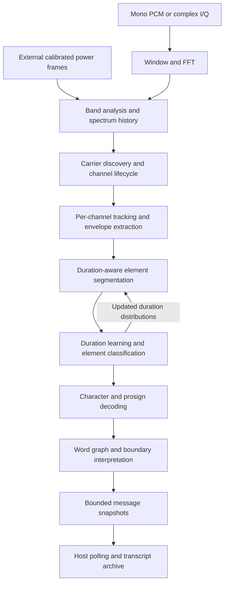

# Decoder design and architecture

libmorsedec turns sampled CW signals into independently tracked, revisable text
streams. Its central design choice is to share frequency analysis across the
retained band while giving every carrier its own signal extraction, timing
model, segmentation state, and message history. This permits simultaneous
signals with different speeds and amplitudes without coupling their learned
Morse timing.

The implementation is synchronous C11. The host owns devices, byte framing,
stream scheduling, and transcript persistence; the library owns signal analysis
and bounded decoding state. A persistent per-handle worker pool can process
channels concurrently; there are no callbacks.
This document describes the current implementation and its tradeoffs. Public
contracts and individual function details are in the [library manuals](man/README.md).

## Pipeline and responsibilities



The diagram shows logical responsibilities. FFT and band management run in the
calling thread. Each channel pipeline runs as one job on the caller or a worker,
with a completion barrier before selection and sorting; there are no asynchronous
stage queues.
The feedback from duration learning to segmentation stays within one channel.

| Module | Responsibility | Principal state or output |
| --- | --- | --- |
| `src/decoder.c` | Configuration, lifecycle, input validation, streaming entry points, public queries | Decoder handle, input mode, frame counter, current channel |
| `src/frontend.c` | Windowed real or complex FFT and calibrated power extraction | Sample rings, window, FFT plan and buffers |
| `src/band.c` | Band-wide peak evidence, history, discovery, merging, retirement and selection | Retained power history, channel slots and ordered view |
| `src/signal.c` | Carrier tracking, normalized spectral shape, envelope and keying confidence | Per-channel filters, delayed observations and carrier state |
| `src/segment.c` | Competing keyed/unkeyed duration paths and retained traceback | Run scores, duration tables and committed-time boundary |
| `src/statistics.c` | Adaptive five-class duration model and element classification | Log-duration means, variances, covariance and learning window |
| `src/character.c` | Element grouping, Morse lookup and fallback splitting | Pending character elements and character records |
| `src/word.c` | Weighted word interpretation and revisable word boundaries | Model graph and independent per-channel path scores |
| `src/message.c` | Overlapping snapshot updates and bounded retention | Up to 500 character records per channel |

`include/morsedec.h` exposes only the supported `md_*` functions and public data
structures. `src/internal.h` connects implementation modules. Internal helpers
also use `md_`, but hidden symbol visibility keeps them out of the shared-library
interface.

## State ownership and stream lifecycle

A decoder handle owns configuration, FFT geometry, band history, tracking slots,
and one word-model graph. All channels in that handle use the same graph topology
and weights, but each maintains its own word scores. Separate handles have
separate graphs and mutable state; there is no process-global decoder state.

Construction validates geometry and allocates the sample, spectral, channel and
model buffers. It also creates the FFTW plan and allocates word states for every
configured channel slot, including inactive slots. Processing, pinning and reset
reuse those allocations. A new channel initializes a free slot rather than
allocating memory.

The host chooses the handle's sample type at construction:

| Handle | Sample input | Frequency interpretation |
| --- | --- | --- |
| `md_new()` | Mono float or signed 16-bit PCM | Nonnegative audio frequency in Hz |
| `md_new_iq()` | Interleaved float or signed 16-bit I,Q pairs | Signed Hz offset from input IF center at 0 Hz |

Either handle can instead accept external power frames. The first successful
processing call selects sample input or spectrum input until reset. Even a
zero-count sample call selects sample mode. Float and signed 16-bit input can be
mixed within the selected handle type; changing between real audio and I/Q
requires a new handle.

A stream normally follows construction, repeated processing and snapshot reads,
flush, final snapshot reads, and deletion. `md_flush()` completes a partial hop,
feeds approximately one second of silence, commits pending output, and seals the
stream. Repeated flush adds no further work. Queries remain available, but input
and pin/unpin operations require reset before use again.

`md_reset()` discards channels, pins, learned statistics, messages, buffered
samples and the input-mode selection. It preserves configuration, handle type,
FFT geometry and allocated storage. It resets the frame count while preserving
the monotonically increasing channel-ID allocator. `md_delete()` releases storage
without implicitly flushing.

## Frequency analysis and calibration

### Sample geometry

Let `fs` be the sample rate, `N` the FFT length, and `H` the hop length. For I/Q,
`fs` and `H` count complex pairs, not individual scalar components. Automatic
geometry is:

```text
N = 2 * floor(fs * 0.064 + 0.5)
H = floor(fs * 0.010625 + 0.5)
bin_spacing = fs / N
frame_seconds = H / fs
```

At 48 kHz this is a 6144-point FFT every 510 samples; at 8 kHz it is a 1024-point
FFT every 85 samples. Both provide 7.8125 Hz bin spacing. FFT length must be even,
at least 64, and fit an `int`. The hop must be between one and `N` samples and
represent 5–20 ms.

The retained band uses bin boundaries `floor(frequency * N / fs + 0.5)` and
excludes the rounded upper boundary. At least 32 bins are required. Each channel
needs ten guard bins on either side for neighborhood analysis. The default
200–1200 Hz audio band retains 128 bins starting at 203.125 Hz; a carrier at a
requested edge therefore is not necessarily inside the usable tracking region.
`md_get_geometry()` exposes the actual rounded grid.

Changing `N` changes the frequency width of the fixed-bin neighborhoods and
changes the analysis aperture. It is consequently an algorithm choice, not just
an FFT performance setting. Keeping the default relationship between sample rate
and window length preserves approximately the same detector behavior across
sample rates. There is no internal decimator or resampler.

### Analysis window

The frontend applies a three-term cosine window multiplied by a centered sinc.
For sample index `i` from zero through `N-1`:

```text
a = 2*pi*25*(i - N/2) / fs
sinc(a) = sin(a)/a, with sinc(0) = 1
w[i] = (0.42 - 0.5*cos(2*pi*i/N) + 0.08*cos(4*pi*i/N))
       * sinc(a) * (8000/fs)
```

The 128 ms nominal aperture provides fine FFT spacing; the sinc concentrates the
effective temporal response to roughly 40 ms. This balances tonal discrimination
and keying resolution. It also limits fast CW: a dot at 40 WPM lasts 30 ms, so
neighboring transitions can overlap in the detector observation.

The FFT is unnormalized. Retained linear power is:

```text
real audio: power[j] = 0.001   * |FFT(w * audio)[k]|^2
complex IQ: power[j] = 0.00025 * |FFT(w * (I+jQ))[k]|^2
```

The `8000/fs` factor stabilizes the power scale across sample rates. The complex
coefficient accounts for the doubled FFT amplitude of an isolated complex
exponential relative to a real sinusoid of equal peak amplitude. These scales
matter because acquisition and confidence use absolute thresholds as well as
ratios.

Float samples are clamped to [-1,1] component by component; NaN and infinities
become zero. Signed 16-bit values are divided by 32768. Computed power that is
non-finite or exceeds float range becomes zero. Power arrays use `float` storage;
the frontend and most decoding calculations use `double`.

### Signed I/Q and external spectra

I/Q input is `I0,Q0,I1,Q1,...`, representing `I+jQ`. With the forward FFT,
`I=cos(2*pi*f*t)` and `Q=sin(2*pi*f*t)` report `+f` Hz. Negative offsets remain
separate from positive offsets. Negative FFT bins are read from the upper FFTW
indices and presented to the decoder in ascending frequency order. The retained
complex grid can span `[-fs/2, fs/2)`; negative Nyquist is available and positive
Nyquist is excluded to avoid duplicate representation.

The handle stores no absolute RF center frequency. Receiver frequency mapping,
I/Q imbalance correction, DC removal and optional subband channelization belong
to the host. A DC offset can therefore appear as a carrier near zero. Swapping
I and Q reverses the reported frequency orientation.

`md_process_spectrum()` enters immediately before band analysis. It consumes one
frame of exactly the retained bin count and advances the same pipeline as a
sample-generated frame. The host must match frequency order, cadence, power
scale, window and alignment. A dB waterfall or an arbitrary FFT window is not an
equivalent input. Invalid or nonpositive external powers become zero. This
boundary permits alternate FFT backends while retaining the channel decoder.

## Time and scheduling

All downstream work is driven by spectrum frames. The canonical timing unit is
`MD_TICK = 0.010625` seconds, with `tick_scale = frame_seconds / MD_TICK`.
Physical filter windows expressed in nominal ticks become
`max(1, floor(ticks / tick_scale + 0.5))` actual frames. A decay coefficient `a`
becomes `a^tick_scale`. Duration scores use `duration_in_frames * tick_scale`.
This preserves physical timing approximately; integer rounding introduces small
cadence-dependent differences.

Sample rings preserve arbitrary chunk boundaries. A processing call may produce
no complete frame or many frames; it does not itself define a timing interval.
The global frame counter advances once per completed hop, and includes flush
padding. It is neither a wall-clock timestamp nor a count of per-channel work.

`md_band_frame()` is the current scheduler as well as the band manager. Each live
frame performs, in order:

1. Advance the frame counter and periodically mark duplicate channels for removal.
2. Store the power frame in history and update band smoothing and peak evidence.
3. Remove retired slots, suppress peaks around surviving channels, and discover
   new channels from the remaining candidates.
4. Periodically update the shared noise estimate.
5. Advance each channel by at most four pending historical frames.
6. Update automatic current-channel selection and sort enumeration by frequency.

The history spans approximately 2.125 seconds. A newly discovered channel starts
at the oldest available frame, then catches up at up to four processed frames
per incoming frame. This can recover the beginning of an ongoing transmission
without stopping live input for an unbounded replay burst. Sample-driven decoding
skips frames before half the FFT aperture plus 20 ms so the effective main lobe
has arrived, while avoiding a wait for the entire window.

Replay preserves source frame numbers and historical power, but it is not a full
rewind of the band manager: shared noise and peakiness state reflect the live
scheduler. Channels that missed the retained history cannot recover that audio.
The bounded work per frame is useful for streaming, but processing time still
varies with channel count, backlog, model updates and traceback.

## Carrier discovery, tracking and selection

Band analysis maintains smoothed power and a peakiness ratio comparing each bin
with bins five positions to either side. Sustained local maxima above the
acquisition threshold become channel candidates after the history warmup.
Suppressing candidates around existing channels reduces duplicate tracks.
Periodic merging compares neighboring channels within three bins, preferring
pinned/current channels, then carrier evidence and message history.

The noise estimate is the upper median of up to 40 bins from the center of the
retained band, updated every 32 nominal ticks. A median tolerates sparse narrow
carriers better than a simple average. It is still a shared central-band
estimate: a crowded central slice or a sloping wideband noise floor can bias
channels elsewhere in the band.

Each channel tracks a local undilated power maximum within two bins when its
peakiness is sufficiently high. A smoothed fractional-bin accumulator determines
integer moves, and the consumed integer move is subtracted from the accumulator.
The channel remains inside the ten-bin guards. This follows gradual pitch drift
without repeated rounding moves, but can be distracted by neighboring signals;
the current search accepts the first qualifying nearby peak.

Channel lifetime and current-channel selection are separate decisions. Channels
can be acquiring, decoding, waiting under a sustained carrier, or retiring.
Signal transitions, learned timing and inactivity govern these states. Short
noise bursts can create candidates without becoming a selected message channel.
Retirement releases the slot and removes its message from the queryable set.

Automatic selection requires a trained duration model or a short transmission
with at least three committed marks followed by sustained silence. It compares smoothed
absolute carrier power, switching only when a candidate is more than four times
the current channel's power. Absolute power avoids comparing differently aged
per-channel normalization floors, and hysteresis reduces selection flapping.
Selection is a convenience for single-message consumers; skimmers should enumerate
all tracked channels.

A pin selects a channel and protects it from automatic switching and retirement,
while discovery and processing of other channels continue. Pinning does not tune
the input or stop pitch tracking. Requests are rounded and clamped to the usable
band. `md_pin_frequency(d, 0)` selects the center when it is usable;
`md_set_frequency(d, 0)` releases the pin. Stable nonzero channel IDs survive
reordering, but expire on retirement or reset.

## Signal extraction and keying observations

A tracked frequency is converted into a soft keying probability rather than
immediately thresholded into dots and dashes. The extractor examines 21 bins
centered on the channel, normalizing by a channel-specific floor derived from
shared noise through running maximum, running minimum and exponential filters.
Fallbacks prevent division by a vanishing floor.

The center's square-root power estimates amplitude. Ten shoulder bins at offsets
four through eight provide background evidence. Their logarithmic products
produce a shoulder estimate; subtracting that estimate from the center amplitude
produces nonnegative prominence. Prominence is capped at 200 to prevent an
almost zero noise floor from giving long marks an arbitrarily large influence
on the decision threshold. The amplitude used for the SNR query is not capped.
A short temporal operation suppresses isolated
excursions, while longer filters estimate carrier presence, signal strength and
an adaptive decision threshold.

The filters serve different purposes. Carrier acquisition uses hysteresis
(enter above 1.3, remain above 1.0 in normalized envelope units), whereas the
keying path compares a delayed prominence observation with a delayed adaptive
threshold. A bounded hyperbolic tangent turns that difference into a probability.
The main keying observation is delayed by 36 nominal ticks, about 382.5 ms.

A second gate limits confidence using tonal contrast: center log power minus
mean shoulder log power. For learned speeds below 28 WPM it uses offsets four
through eight. From 28 to 34 WPM it blends toward offsets six through ten, which
leave room for the wider spectrum of short marks. Both observations are delayed
to match keying, then interpreted using the latest speed estimate from all three
mark/element-gap means. This avoids interpreting a hand-keyed sender's short dots
alone as evidence of fast CW. The resulting contrast maps
through `0.5*tanh(2*(contrast - ln(8))) + 0.5`. A large broadband impulse therefore
cannot become a confident mark on amplitude alone. The final key probability has
a small positive floor to keep logarithmic observations finite.

Sliding extrema use block suffix accumulations with constant amortized work.
Moving averages use rings and periodically recompute their sums to bound
roundoff. The delayed feature matrix currently shifts rows on every channel
frame. The exported strength and SNR values are useful internal diagnostics;
they are not calibrated receiver measurements.

## Segmentation and adaptive timing

### Competing run hypotheses

The segmenter keeps competing keyed and unkeyed run-duration hypotheses. A state
means that the current mark or gap has reached a particular length. Each frame
adds `log(p_key)` or `log(1-p_key)` and a duration-dependent continuation or
termination score. Dynamic programming compares continuing the present run with
starting the opposite run.

At default cadence the explicit keyed chain has 20 states and the gap chain has
30. Saturated end states retain run-extension counters, so these chain lengths
do not impose an absolute maximum mark or silence duration. Counter saturation
prevents integer overflow during indefinite silence.

A 50-tick observation window retains 25 ticks after a decision. Traceback commits
older elements while keeping recent context for the next decision; carrier loss
also triggers a traceback. Initial state is an established gap so a mark at the
beginning of usable input does not require an invented preceding element.

Traceback may revisit context. A monotonic committed-time boundary rejects
already emitted runs and clips overlapping durations before they reach learning
or character decoding. This prevents one physical interval from being counted
twice after carrier loss. Scores are renormalized and inconsistent paths are
pruned to keep the retained state numerically useful.

### Five duration classes

The duration model distinguishes dots, dashes, intra-character gaps,
inter-character gaps and inter-word gaps. Positive committed durations are
marks; negative ones are gaps. Class distributions operate in log duration,
which represents relative timing variation naturally across speeds. Gap scores
also include broad tails so long pauses remain representable.

Learning collects alternating runs into a 14-element window. When it contains
seven marks and seven gaps, the estimator sorts their log durations and scores
candidate partitions into the five classes. Within-class squared residuals,
scaled by the initial class variances, measure how well each partition fits the
observed durations. A covariance-based penalty and fixed partition priors
regularize sparse or ambiguous observations. Gaps of at least 60 nominal ticks
are replaced by the longest shorter gap for partition fitting, or the current
word-gap mean when no shorter gap exists; long silences do not set the sender's
spacing. Inferring an absent class converts each observed class mean back to dot
units, including the word-gap ratio. Weighted candidate
estimates classify the window, and covariance-aware updates adapt the duration
means and variances. Variance bounds and ordering constraints keep the classes
usable. The updated model marks segmentation's duration tables dirty; those
tables are rebuilt before the next observation.

During initial learning, a bounded 256-element pending buffer preserves elements
until classification has enough context. Long acquisition silence is excluded
from the training window. A carrier drop alone does not end learning: at slow
speeds an ordinary word gap can briefly drop the carrier. After 75 nominal ticks
(about 0.8 seconds) without a carrier, a pending transmission with at least three
marks is classified using the current model and becomes eligible for automatic
selection. Explicit stream flush also permits this release. Isolated marks and
noise excursions do not satisfy the automatic short-transmission gate. A pinned
channel may release even a single mark without qualifying as a trained channel.
Flush runs channel selection after releasing pending text, so a short message
that ends on its last mark does not need extra host-provided silence to become
the current channel.

`initial_wpm` shifts the initial means and regularization toward a known sender
speed. It does not fix the model or establish an assured decode range. Reported
speed uses PARIS timing. Because segmentation and learning reinforce one another,
bad early boundaries can bias later duration estimates; confidence-aware learning
and abrupt sender-speed changes remain important areas for evaluation.

## Characters and word interpretation

Character assembly accumulates marks and short gaps until a classified letter or
word gap closes a run. Dots and dashes form a pattern that is looked up in the
Morse table, including punctuation and procedural signals. A bounded fallback
tries splitting unknown patterns around a dash-dot delimiter; unresolved runs
produce `*`. Split characters retain the left-to-right order of the input.
Runs are bounded to avoid unbounded accumulation or recursion.

Character records preserve a Latin-1 byte, source ordinal, low-SNR evidence and
word-boundary evidence. Prosigns can produce multiple lowercase records from one
pattern. Ordinals reserve 256 positions per source frame to distinguish those
records. The ratio between word-gap and letter-gap scores supplies boundary
evidence; a long gap or flush can force a boundary with the sentinel value 2.0.

Word interpretation uses a weighted graph constructed from dictionary entries,
report/prosign patterns, callsign grammar and generic fallbacks. Emitting nodes
match literals or letter/digit/generic classes; non-emitting selector nodes
combine paths. Outgoing weights are normalized and stored as log scores. Each
channel advances its own states in a bounded Viterbi-style update, then uses
saved lengths and classes to reconstruct word boundaries.
Score normalization includes the root hypothesis that starts a new word, so
its score remains comparable to paths that continue the current word.

The current implementation keeps a rolling 26-character window, allowing word
interpretations to span element batches. Repetition heuristics retain plausible
boundaries in repeated exchanges. Older word labels and spaces may change when
new characters arrive.

This stage interprets the character sequence it receives. It does not carry a
beam of alternative dot/dash paths or generally repair mistaken character bytes.
Hard element and character decisions limit how much later word evidence can
recover. Increasing dictionary influence alone cannot solve missed transitions.
Graph selector updates also depend on traversal order; parallel or indexed
implementations must preserve those dependencies and score tie behavior.

## Message identity, revisions and host integration

Each channel retains at most 500 character records. New word batches can overlap
previous output: the message layer locates the ordinal overlap, preserves any
identical prefix, and replaces the revised suffix. Equality includes the byte,
word label, ordinal, low-SNR flag, boundary probability and space count.
Overflow discards oldest records in groups of 125 to create room.

Snapshots deliberately expose current interpretation. `md_get_characters()`
borrows the array until the next mutation; `md_get_text()` copies bytes and the
current spaces into caller storage. Neither consumes messages. A host that
appends every snapshot will duplicate text and fail to apply revisions. A
persistent skimmer should archive records by handle, channel ID and ordinal,
apply updates while the channel exists, and collect output after flush.

Channel summaries are copied values, enumeration positions can change each frame,
and channel retirement removes query access to its history. A zero query ID
means the current channel and yields an empty result when none exists. A missing
nonzero ID returns `ENOENT`. The scalar frequency getter retains a -1 absence
sentinel, which overlaps a valid signed I/Q offset; use state or enumeration to
disambiguate.

Device integration and presentation stay outside the core. The command-line
tools use the same public interface:

| Tool | Responsibility |
| --- | --- |
| `morsedec-audio` | libsndfile-backed files or raw input, with optional two-channel I/Q interpretation |
| `morsedec-live` | Raw mono or selected/mixed multichannel audio from stdin |
| `morsedec-iqlive` | Raw interleaved I,Q stdin with signed IF frequencies |

The live tools share transport and shutdown handling in `tools/live-common.c`.
All three tools parse short options with POSIX `getopt`. File input uses the
remaining operand after option parsing; the live tools reject operands and
read stdin. Long option names are not accepted. Common option letters have
the same meaning across tools, including `-r` for sample rate, `-F` for sample
format, `-f` for pin frequency, `-l`/`-u` for band edges, and `-V` for version.
They retain incomplete byte frames between reads and reject truncated input at
EOF. JSON and text outputs contain snapshots; CSV exposes per-hop diagnostics.
The library itself does not detect device overruns, missing samples or RF tuning
changes.

## Resources, concurrency and failure behavior

Memory is bounded after construction but is not small. Per-channel structures
reserve generous fixed-capacity arrays for filters, delay features, segmentation,
pending elements and messages. Reducing the sample rate shrinks FFT storage but
does not shrink these fixed channel arrays. The word graph also reserves node
and edge capacities beyond the topology currently used.

For retained-bin count `B` and history length `R`, the spectral history alone
costs `4*B*R` bytes. The three band working arrays and peak flags add about `13*B`
bytes. The real frontend's owned arrays use approximately `32*N+16` bytes; the
complex frontend uses `56*N`, excluding FFTW plan internals and allocator
metadata. Total channel storage grows with configured capacity, not just the
number of active signals. On a typical 64-bit build, a channel structure is
roughly 149 KiB before its separate word-state array.

Stack use also matters on embedded targets: segment traceback reserves
`MD_TIME_MAX` element records locally, and fallback character splitting uses
bounded recursion. Allocation-free streaming does not mean negligible stack
requirements. Construction, processing time and peak memory should be measured
on the deployment architecture.

Every call touching one handle must be serialized, including queries and borrowed
views. Independent handles may process concurrently after construction.
Construction and destruction must be serialized with all FFTW planning and
plan-destruction operations in the application. The library never calls global
`fftw_cleanup()`. FFTW execution remains single-threaded within each handle.

### Per-channel workers

`md_new()` and `md_new_iq()` select automatic scheduling. Their
`md_new_with_threads()` and `md_new_iq_with_threads()` variants accept a total
participant budget including the caller: zero selects automatic mode, one creates
no workers, and larger values explicitly enable channel parallelism. Automatic
mode uses the OS-reported online logical CPU count, capped by channel capacity.
Explicit budgets are also capped by channel capacity. `md_get_thread_count()`
reports the resolved budget, not the number currently running. Applications with
several handles should assign their own budgets to avoid oversubscription.

The private pthread backend (winpthreads on MinGW) allocates the pool and starts
workers after frontend construction. `-Dparallel=auto` enables it when detected;
`enabled` requires it and `disabled` builds a serial backend. Unsupported explicit
parallel requests fail with `ENOTSUP`. Automatic initialization failure cleans up
partially started workers and falls back to serial; explicit requests propagate
the initialization error. Reset preserves the budget and pool. Deletion wakes
and joins workers before freeing decoder storage.

Each band frame first performs its existing merge, history, peak detection,
slot retirement/creation and noise updates serially. It clears each channel's
change flag, applies frontend validity limits, and builds a preallocated list of
channels with replay work. Automatic mode keeps fewer than four runnable channels
serial; explicit mode may parallelize two. Participating workers are limited by
both the budget and job count, and receive individual condition-variable signals.
Idle workers sleep. The caller also claims channel jobs through a short mutex.
Workers receive the caller's floating-point environment on each dispatch so
rounding-mode changes after construction do not change channel results.

A job retains the existing maximum of four chronological replay frames. Its
entire extraction, segmentation, timing, character, word and message path updates
only that channel. History, band ratios, noise, configuration, frame counters and
word-model topology remain read-only until every participant acknowledges the
hop's completion. Generation counters distinguish dispatches; the barrier also
waits for signaled workers that have not claimed any work. Only then can selection,
sorting or the next frame run. Explicit flush's final commit loop remains serial.

Processing remains synchronous and allocation-free, including reset and flush;
worker synchronization can wait for OS scheduling but performs no blocking I/O.
No additional stream buffering or algorithmic latency is introduced. Thread wakeups
increase CPU use and can cost more than they save on small workloads. Use `-p 1`
in the CLI or the serial constructors to compare against automatic mode. No CPU
pinning, scheduling-priority changes or global worker pool is used.

Fallible integer functions return 1 or 0 and set `errno` on failure. Constructors
return an owned handle or NULL. Invalid arguments, geometry, input-mode changes
and sealed-stream mutations produce `EINVAL`; allocation/planning failures
produce `ENOMEM`. Pinning with no free slot or copying text into an undersized
buffer produces `ENOSPC`. Text sizing reports the required capacity including
NUL and never writes a truncated string. Scalar queries have documented absence
defaults rather than errno-based failures.

The public ABI is version 1, introduced with library version 0.2.0. Public
functions use `md_*`; public data types, constants, the header and library name
retain their `morsedec` names. Only declarations marked `MORSEDEC_API` are exported.

## Evaluation evidence and architectural limits

Earlier evaluations covered numeric primitives, geometry, chunk independence,
input validation, frequency drift, traceback overlap, reset/flush, I/Q placement
and calibration, and synthesized multicarrier messages. Meson runs the pattern
and parallel-processing regression checks with
`meson test -C build`. Deterministic generated inputs compare serial and parallel
snapshots, input chunking, acquisition replay, reset/flush and channel lifecycle;
Linux additionally injects allocation and worker-start failures. Shared/static and
sanitizer build configurations remain available; CI builds the library and tools.

The [archived benchmark report](benchmarks/README.md) records transcripts,
checksums, decoder output and edit-distance metrics for three recordings used
for tuning. Those measurements do not establish accuracy on unseen senders or
interference conditions. Available evidence is stronger for clean moderate-speed
audio and a few separated carriers than for crowded wideband SDR operation.

Important current limits follow directly from the architecture:

- Shared central-band noise estimation can misrepresent other portions of a
  crowded or uneven band.
- Fine frequency spacing does not remove the roughly 40 ms effective timing
  response; 30–40 WPM decoding still exhibits errors.
- History and replay are bounded, so late acquisition can lose a short message.
- Tracking and merge neighborhoods can confuse closely spaced or crossing tones.
- Early element/character decisions discard alternatives that the word graph
  cannot reconstruct later.
- Fixed-capacity per-channel arrays and double-precision arithmetic make the
  current implementation expensive for small microcontrollers.

Useful next architectural steps are to size buffers from actual timing needs,
index and compact the immutable graph, and cache configuration-derived
coefficients before changing the algorithms. An optional lower-rate frontend
would need anti-alias filtering and explicit delay accounting. A faster
per-channel detector could separate frequency acquisition from keying resolution.
A bounded character-hypothesis interface could let timing and word evidence
resolve ambiguity together. These are development directions, not existing
backends or accuracy guarantees; each needs intermediate-stage comparisons and
independent recording evaluation.
